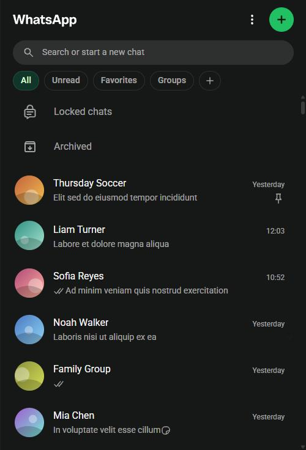
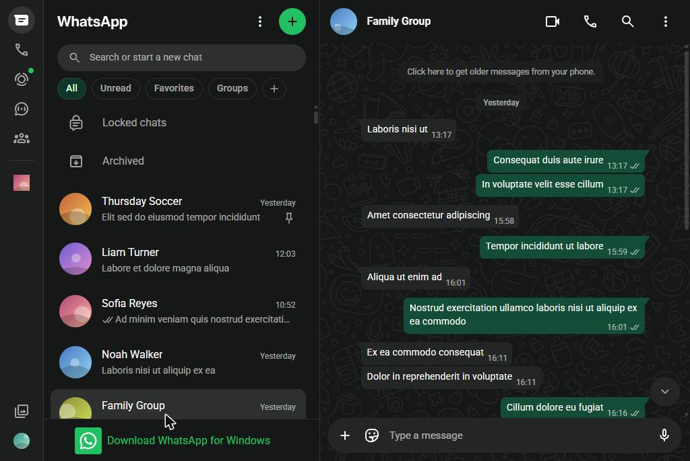

# Side Panel for WhatsApp

An extension for Vivaldi (and other Chromium browsers) that makes WhatsApp Web usable in a narrow side panel. Below a width you choose, it shows one pane at a time, like Telegram: the chat list or the open chat, with a back button. Above that width you get the normal full page.

The interface follows your browser's language automatically. Supported: English, Spanish, French, German, Italian, Portuguese (Brazil and Portugal), Russian, Chinese (Simplified and Traditional), Japanese, Korean, Arabic, Hindi, Turkish, Dutch, Polish and Indonesian. Any other language falls back to English.

| Chat list | Wider than the threshold |
|---|---|
|  |  |

Screenshots of the real page with placeholder names, pictures and messages.

## Installation

1. Open `vivaldi://extensions` and turn on **Developer mode**.
2. Click **Load unpacked** and select this folder.
3. Click the extension's icon in the toolbar to open WhatsApp in the side panel.

### If the panel does not open

Vivaldi only partly supports `chrome.sidePanel`. As an alternative, add WhatsApp as a web panel: click **+** (Add Web Panel) in the side bar and enter `https://web.whatsapp.com`. The layout works the same way.

## Settings

Open the extension's **Options** (right-click its icon, or from `vivaldi://extensions`):

- **Enabled**: turns the layout on or off.
- **Maximum width**: below this value, the single-pane layout is used (700 px by default).
- **Icon bar next to the chat list**: shows Status, Channels and Settings next to the list. Off by default; you can also just widen the panel.
- **Copy diagnostics**: copies the page structure, with no text, names or numbers, to help work out what broke if WhatsApp changes its layout.

## Known limitations

- It relies on `#side`, `#main` and the column structure of WhatsApp Web, which can change. If the layout is not recognized, the page stays as it is and the options page says so.
- The back button closes the chat by simulating Esc, so new messages are not marked as read. If that fails, the chat stays open behind the list and the options page warns you.
- From a chat opened in Archived, the back button returns to the main list, because Esc closes Archived too.
- In the extension's panel, WhatsApp runs in an iframe. To allow that, `background.js` removes `X-Frame-Options` and `Content-Security-Policy` and changes the `Sec-Fetch-*` headers, for that iframe only. If WhatsApp changes its server checks, the page may stop loading; the web panel remains as a fallback.
- Vivaldi's panels present themselves as a mobile browser, and WhatsApp answers with its "use a computer" page, so the extension sends WhatsApp a desktop user agent (`background.js`, `desktop-ua.js`).
- WhatsApp allows one active window: the panel, tabs and web panels compete for the session through the "Use here" prompt.
